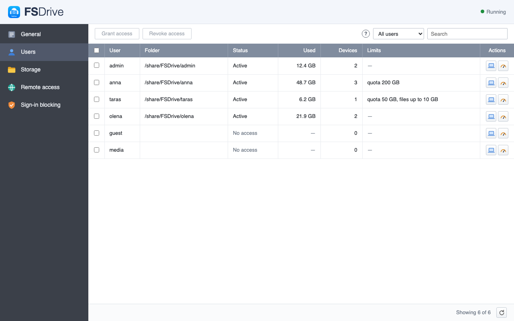
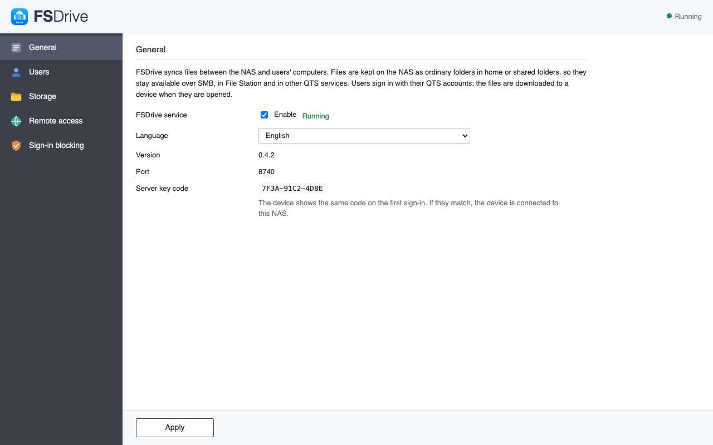
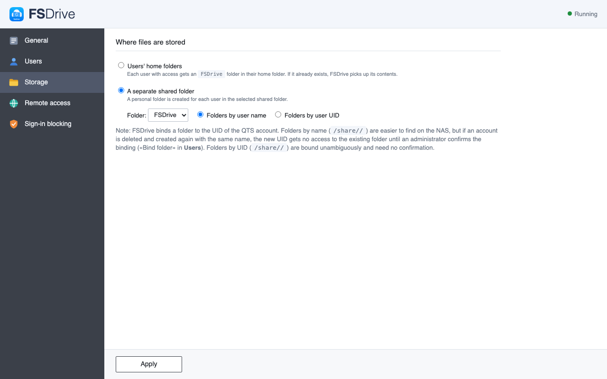

# FSDrive — синхронізація файлів із NAS

Ваш NAS як власна хмара: сервер працює на NAS, а клієнт показує файли в Finder, як iCloud Drive, із
завантаженням на вимогу. На NAS файли лежать **звичайними теками** у вибраній спільній або домашній теці,
тож їх і далі можна відкрити через SMB, Finder чи `ls` і забрати без FSDrive. Вхід — обліковим записом NAS.
Архітектура: [docs/ARCHITECTURE.md](docs/ARCHITECTURE.md).

| | |
|---|---|
|  |  |
| Загальні: служба, мова, код ключа сервера | Сховище: домашні теки або окрема спільна тека |

Віддалений доступ ([скрін](docs/screenshots/qnap-4-access.png)): переадресація порту на роутері, HTTPS через
зворотний проксі або SSH-шлюз. Скріни зроблено з демонстраційними даними.

## Встановлення

| Що | Де взяти |
|---|---|
| Сервер на QNAP | App Center → Налаштування → «Репозиторій застосунків» → «Додати»: `https://romulas-12.github.io/fsdrive-packages-qnap/repo.xml` ([сторінка пакета](https://github.com/Romulas-12/fsdrive-packages-qnap)) |
| Сервер на Synology | Package Center → Settings → Package Sources → «Add»: `https://romulas-12.github.io/fsdrive-packages-synology/x86_64.json` (Intel/AMD) або `…/armv8.json` (ARM) ([сторінка пакета](https://github.com/Romulas-12/fsdrive-packages-synology), [налаштування](Server/README.md#сервер-на-synology-spk)) |
| Клієнт для macOS | Збірка з `Clients/macOS` ([як зібрати](Clients/macOS/README.md)) |
| Клієнт для Windows | Згодом (x86_64 і ARM64) |

Як працює сервер — [Server/README.md](Server/README.md); клієнти — [Clients/macOS/README.md](Clients/macOS/README.md).

## Пов'язані репозиторії

- [Romulas-12/fsdrive](https://github.com/Romulas-12/fsdrive) — цей: код сервера, клієнтів і пакування.
- [Romulas-12/fsdrive-packages-qnap](https://github.com/Romulas-12/fsdrive-packages-qnap) — зібрані пакети
  для QNAP App Center; публікує `Server/scripts/publish-repo.sh qnap`.
- `fsdrive-packages-<система>` — так само для Synology та інших NAS.

## Будова репозиторію

Один git-репозиторій, у якому кожна частина живе у своїй теці й розвивається окремо:

| Тека | Що це | Як відкрити |
|---|---|---|
| [`Server/`](Server/README.md) | Сервер `fsdrived`, спільний для всіх клієнтів; протокол і бібліотеки для клієнтів (`FSDriveCore`, `FSDriveClientKit`); пакування під NAS у `Server/Packaging/<система>` | `Server/Package.swift` у Xcode або `swift build` |
| [`Clients/macOS/`](Clients/macOS/README.md) | Застосунок для macOS (рядок меню + Finder) | `Clients/macOS/FSDrive.xcodeproj` |
| `Clients/<платформа>/` | Наступні клієнти (наприклад, `Clients/Windows`) | — |
| `Design/` | Іконки й генератор іконок для всіх платформ | — |
| `docs/` | Архітектура всієї системи | — |

Клієнти залежать від сервера лише через протокол (`/v1`) і, якщо написані на Swift, через пакет `Server`.
Новий клієнт — це нова тека в `Clients/`: сервер і наявні клієнти від неї не змінюються.

## Ліцензія

AGPL-3.0, див. [LICENSE](LICENSE).

## Гілки

`main` — стабільний стан. Робота ведеться в коротких гілках з префіксом частини, яку вона змінює:

- `server/<тема>` — сервер, протокол, `FSDriveCore`/`FSDriveClientKit`, пакування для NAS;
- `macos/<тема>` — застосунок для macOS;
- `windows/<тема>`, `<платформа>/<тема>` — інші клієнти;
- `docs/<тема>`, `design/<тема>` — документація та іконки.

Зміна протоколу, що зачіпає і сервер, і клієнти, іде однією гілкою `server/<тема>` разом з оновленням
клієнтів, щоб `main` завжди збирався цілком.
