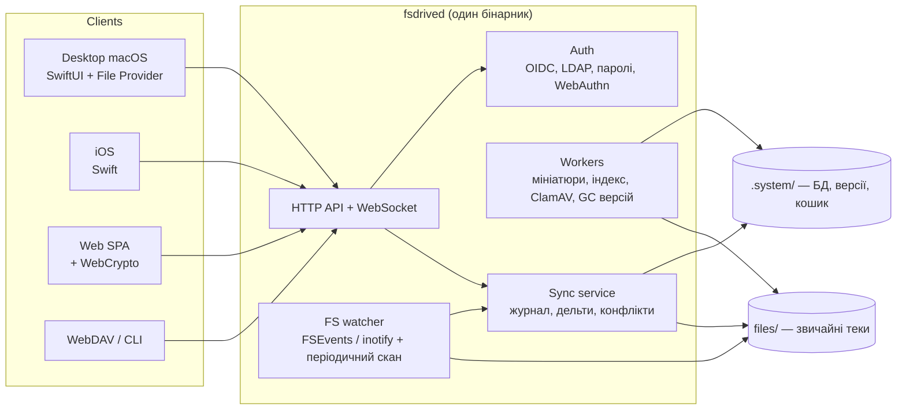

# Архітектура FSDrive

Статус: чернетка v0.1 · 2026-10-23

## 1. Мета

Синхронізація файлів із власним NAS: сервер на NAS, клієнти на комп'ютерах і телефонах.
Сервер синхронізації та спільного доступу до файлів, який:

1. **Зберігає файли як звичайне дерево тек.** Дані на сервері можна відкрити у Finder,
   Samba, `ls`, зробити бекап через `rsync`/Time Machine і забрати без нашої програми.
   Це головна вимога, і вона важливіша за будь-яку оптимізацію сховища.
2. Синхронізує швидко й надійно: дельта-передача, відновлення перерваних завантажень.
3. **Мало навантажує систему навіть при передачі сотень гігабайтів.** Сервер (Mac) має
   лишатися придатним до звичайної роботи під час великої синхронізації (див. §6.1).
4. Розгортається одним застосунком на NAS, без Docker і зовнішніх сервісів (див. §11).

Цільова платформа сервера — **QNAP (QTS 5, ARM64) як нативний застосунок App Center (QPKG)**, без Docker.
Сервер — Linux-бінарник разом із власним glibc і його завантажувачем (`scripts/build-linux.sh`),
тож не залежить від старого glibc у QTS (2.23). Повністю статична збірка на musl не підходить: готовий
runtime Swift Static SDK використовує атомарні інструкції ARMv8.1, а Cortex-A72 у TS-x35 — ARMv8.0.
Той самий код працює і на macOS.

## 2. Принципи

| # | Принцип | Наслідок |
|---|---|---|
| P1 | **Файлова система — джерело істини для вмісту** | Жодних блоків/чанків як основного сховища. БД — лише індекс і журнал |
| P2 | **Один бінарник, одна мова ядра** | Swift; той самий `FSDriveCore` у сервері, CLI та клієнтах macOS/iOS. Системні бібліотеки (CryptoKit, SQLite3, FSEvents) замість залежностей |
| P3 | **Працює з коробки на одному вузлі** | SQLite + локальна тека; Postgres — опційно для великих інсталяцій |
| P4 | **Зовнішні зміни — норма** | Файл, змінений у Finder/SMB прямо на сервері, стає звичайною версією |
| P5 | **Жодного open-core** | Пошук, S3, аудит, блокування, антивірус — у єдиній відкритій версії (AGPLv3) |
| P6 | **Сучасна криптографія без legacy-режимів** | Лише AEAD, Argon2id, без вибору «слабшої версії» |
| P7 | **Кожен байт читається й пишеться на сервері один раз** | Хешування під час запису, без повторних проходів, без буферизації файлів у пам'яті |

## 3. Розкладка даних на диску

```
/srv/fsdrive/                         ← корінь даних (задається в конфігу)
├── files/                          ← ЦЕ відкривається у Finder
│   ├── user1/
│   │   ├── Документи/              ← бібліотека = звичайна тека
│   │   │   ├── Звіти/2026/q3.xlsx
│   │   │   └── договір.pdf
│   │   └── Фото/
│   └── team-marketing/             ← бібліотека групи
│       └── Брендбук/
└── .system/                        ← службове; Finder може його не показувати
    ├── db.sqlite                   ← індекс, журнал змін, користувачі, права
    ├── versions/<lib-id>/<file-id>/<version-id>   ← попередні версії файлів
    ├── trash/<lib-id>/...          ← кошик (зберігає відносні шляхи)
    ├── uploads/                    ← тимчасові файли незавершених завантажень
    ├── thumbnails/
    └── (пошук — таблиці FTS5 у тій самій SQLite)
```

Правила:

- `files/` і `.system/` **мають бути на одній файловій системі**, щоб `rename()` був атомарним,
  а версії створювались через `clonefile`/reflink (APFS, Btrfs, XFS, ZFS) майже безкоштовно.
  Без підтримки reflink версія копіюється.
- Бібліотека — тека `files/<власник>/<назва>/`. Перейменування бібліотеки = перейменування теки.
  Ідентичність бібліотеки й файлів тримається в БД через стабільні `lib_id`/`file_id`,
  а не через шлях, тому перейменування не ламає історію та посилання.
- Сервер нічого не дописує всередину `files/`: жодних прихованих метафайлів.
- **Імпорт наявної теки**: можна вказати вже наявну теку (наприклад, на NAS). Сервер
  проіндексує її як бібліотеку, нічого не переміщуючи.

### 3.1 Імена файлів (критично для macOS)

- У БД імена зберігаються в Unicode NFC, порівняння — за NFC. На диск пишеться NFC.
  macOS (NFD у старих версіях HFS+) і Linux мають бачити один і той самий файл.
- Колізії регістру (`Report.pdf` і `report.pdf`) відхиляються сервером. Інакше вони
  ламаються на нечутливих до регістру APFS/NTFS у клієнтів.
- Імена, неприпустимі у Windows (`:`, `?`, `CON` тощо), дозволені на сервері, але клієнт
  Windows показує їх як конфлікт і не синхронізує, доки файл не перейменують.

### 3.2 Користувачі QNAP (сервер на QTS)

- Кожен дозволений користувач QTS має одну особисту бібліотеку. Де вона лежить, вирішує адміністратор:
  `<домашня тека>/FSDrive` або `<спільна тека>/<ім'я або uid>`. Службова тека (завантаження, версії,
  кошик) — у `.system/libs/<ім'я>` самого сервера, куди користувачі не мають доступу, якщо це той самий том;
  інакше `.fsdrive-system` поруч з бібліотекою. Стара `.fsdrive-system` переноситься автоматично.
- Сервер працює від root, але в теках, куди може писати користувач, ніколи не йде за символьними
  посиланнями: шлях проходиться покомпонентно через `openat(…, O_NOFOLLOW)`, а всі дії виконуються
  відносно дескрипторів теки (`Dir`). Читає файли сервер із правами самого користувача (`setfsuid`/
  `setfsgid` і його групи, лише для поточного потоку), тож ядро застосовує його права й ACL.
- Вхід — ім'ям і паролем QTS, які перевіряє сама QTS (`authLogin.cgi`); FSDrive видає токен на пристрій і
  зберігає лише його хеш. Доступ перевіряється на кожному запиті, тож зняття позначки діє одразу.
- Файли, які записує FSDrive, отримують власника-користувача і групу `administrators` (`0660`/`0770`).
- Обліковий запис прив'язаний до uid: при збігу імені й іншому uid тека не віддається без підтвердження.

## 4. Модель метаданих

Вміст — у файлах, метадані — у БД (SQLite за замовчуванням, Postgres для кластера).

```
library(lib_id, owner, name, path, mode{plain|e2ee}, created_at, history_policy)
node(file_id, lib_id, parent_id, name_nfc, kind{file|dir|symlink},
     size, mtime, content_hash, version_id, deleted)
version(version_id, file_id, size, content_hash, chunk_manifest, author, device, created_at,
        storage{current|versions|trash})
change(lib_id, seq BIGINT, file_id, op{create|modify|move|delete|restore},
       version_id, old_path, new_path, author, device, at)        -- журнал
lock(file_id, holder, expires_at)
acl(lib_id, path_prefix, principal, perm{r|rw|admin})
share_link(token, lib_id, file_id|path, perm, password_hash, expires_at)
device(device_id, user_id, name, token_hash, last_seen, revoked)
```

- `content_hash` — SHA-256 від списку хешів чанків (дерево Меркла з одного рівня). Сервер
  отримує його, перевіривши кожен чанк під час запису, без другого читання файлу (P7).
  SHA-256 з CryptoKit використовує апаратні інструкції ARMv8 і не потребує залежностей.
- `chunk_manifest` — список `(sha256, offset, len)` після FastCDC (у середньому 1 МБ,
  мінімум 256 КБ, максимум 4 МБ). Потрібен лише для дельта-передачі (§6), а не для зберігання.
- `change.seq` — монотонний лічильник у межах бібліотеки. Це основа синхронізації: клієнт
  просить зміни після останнього баченого `seq`.
- **Знімок на будь-який момент** = стан журналу до `seq` + файли з `versions/`.
  Відновлення бібліотеки «на вчора» не потребує окремого сховища.

## 5. Компоненти



Розбиття коду:

```
Package.swift
Sources/
  FSDriveCore/   модель, FastCDC, SHA-256, обгортка SQLite, нормалізація імен, DTO API
  fsdrived/      сервер: Hummingbird (SwiftNIO), сховище, журнал, завантаження, скан
  fsdrive/       CLI-клієнт і рушій синхронізації
apps/          (пізніше) web SPA, macOS-застосунок із File Provider, iOS
```

Ролі одного бінарника: `fsdrived serve`, `fsdrived worker`, `fsdrived admin …`. На одному вузлі
все працює в одному процесі. Redis не потрібен. У кластері події розносяться через
Postgres `LISTEN/NOTIFY`.

## 6. Протокол синхронізації

HTTP/2, тіла запитів у JSON (великі списки — CBOR), сповіщення через WebSocket. Версія API — у шляху (`/v1`).

**Отримання змін (сервер → клієнт)**

1. Клієнт тримає курсор `last_seq` для кожної бібліотеки.
2. `GET /v1/libs/{lib}/changes?since=last_seq` повертає сторінку змін.
3. Для кожного зміненого файлу клієнт бере `chunk_manifest` нової версії та завантажує
   **лише відсутні в нього чанки**: `GET /v1/libs/{lib}/files/{file_id}/chunks?ids=…`.
   Сервер віддає їх як діапазони байтів зі звичайного файлу. Потім клієнт збирає файл у
   тимчасовому місці й атомарно підміняє його.
4. WebSocket `/v1/events` шле `lib_id + seq`, тож клієнту не треба постійно опитувати сервер.

**Відправлення змін (клієнт → сервер)**

1. `POST /v1/libs/{lib}/uploads` з метаданими (шлях, `base_version_id`, розмір, `content_hash`,
   `chunk_manifest`).
2. Сервер відповідає, яких чанків у нього немає. Він шукає їх серед попередніх версій цього
   файлу та серед файлів із таким самим `content_hash`. Наприклад, при перейменуванні
   великого файлу чи копіюванні не передається жоден байт.
3. Клієнт заливає відсутні чанки (`PUT …/uploads/{id}/chunks/{hash}`, паралельно; перерване
   завантаження продовжується).
4. `POST …/uploads/{id}/commit`: сервер збирає файл у `.system/uploads/`, перевіряє SHA-256,
   робить `fsync`, зберігає стару версію у `versions/` жорстким посиланням (`link()`, нуль
   копіювання) і робить `rename()` нового файлу на місце старого в `files/`.
   Запис у журнал і оновлення `node` відбуваються в одній транзакції БД.

### 6.1 Мале навантаження на систему

Мета: передача 500 ГБ не повинна помітно гальмувати Mac-сервер. Орієнтири для MVP —
пам'ять процесу до 200 МБ незалежно від розміру файлів, CPU не більше 1–2 ядер при
гігабітній мережі.

| Де | Як |
|---|---|
| Нарізка на чанки (FastCDC) | **Лише на клієнті.** Сервер отримує готовий маніфест і не читає файл для нарізки |
| Хешування | SHA-256 з CryptoKit (апаратні інструкції ARMv8, понад 2 ГБ/с на ядро). Кожен чанк хешується в потоці, поки пишеться на диск. `content_hash` виводиться з хешів чанків, без другого проходу |
| Пам'ять | Потокова обробка з буферами фіксованого розміру. Файл ніколи не тримається в RAM цілком. Кількість одночасних завантажень обмежена семафором, при перевищенні — `503 + Retry-After` (backpressure) |
| Збереження версій | Жорстке посилання (`link()`) на старий файл перед `rename()` нового: версія створюється миттєво, без копіювання байтів. Якщо не вдається — `clonefile()` на APFS |
| Повторне використання чанків | Незмінені чанки копіюються зі старої версії диск→диск великими блоками; мережею вони не йдуть |
| Віддача файлів | Цілий файл або діапазон віддається через `sendfile()` (без копій у user space), якщо з'єднання без TLS. Для TLS — SwiftNIO SSL з апаратним AES-GCM |
| Дрібні файли | Пакування: багато дрібних файлів або чанків в одному HTTP-запиті, щоб уникнути накладних витрат на запит |
| Стиснення | Вимкнене за замовчуванням (медіа й так стиснені); опційно zstd для текстових типів |
| `fsync` | `F_BARRIERFSYNC` на macOS (гарантує порядок записів) замість дорогого `F_FULLFSYNC`; один на файл, а не на чанк |
| БД | SQLite у режимі WAL; записи журналу пакуються в одну транзакцію на завантаження |
| Фонова робота | Скан, мініатюри, індексація, GC працюють із QoS `background` (`QOS_CLASS_BACKGROUND`): macOS сама обмежує їм CPU та I/O, коли система зайнята |
| Сканування | Порівняння `(size, mtime, inode)` без читання вмісту; хешуються лише змінені файли. FSEvents з подіями на рівні файлів, без опитування |
| Сон Mac | Під час активних передач тримається `IOPMAssertion` проти простою; без передач система може засинати як завжди |
| Обмеження швидкості | Опційні ліміти на клієнта й на сервер у цілому |

**Конфлікти**

- Оптимістична конкуренція: якщо `base_version_id` ≠ поточна версія, сервер не перезаписує
  файл, а зберігає новий вміст поруч як
  `назва (конфлікт, Пристрій, 2026-10-23 14.05).ext` і пише це в журнал.
- Клієнт ніколи не втрачає локальну версію: при конфлікті вона завжди лишається на диску.
- Переміщення й видалення тек обробляються за `file_id`. Тому «перемістив теку на одному
  пристрої, змінив файл у ній на іншому» дає змінений файл у новому місці, а не дублікат.

## 7. Зовнішні зміни на сервері

Файли в `files/` можна змінювати напряму: у Finder на Mac-сервері, через SMB із NAS чи скриптом.

- **Watcher** (FSEvents на macOS, inotify/fanotify на Linux) ставить змінені шляхи в чергу.
- **Узгоджувальний скан** працює щогодини і при старті. Він порівнює `(size, mtime, inode)`
  з `node` і хешує лише те, що відрізняється. Це страхує від втрачених подій watcher-а.
- Зміна оформлюється як звичайний запис журналу з `device = "server-local"`. Клієнти
  отримують її як будь-яку іншу.
- Попередня версія файлу, зміненого ззовні, **не може бути збережена заднім числом**, бо
  її вже перезаписано. Для захисту від цього є опційний режим: тека `files/` монтується
  лише для читання (через SMB або Finder) і змінюється тільки через сервер чи WebDAV.

## 8. Наскрізне шифрування (E2EE-бібліотеки)

Бібліотека може мати режим `e2ee`: сервер зберігає лише зашифровані дані й не знає ключів.

- **Структура тек зберігається, вміст і імена — ні.** Кожен файл шифрується окремо й
  лежить у дереві під зашифрованим ім'ям, як у Cryptomator. Відкрити його у Finder на
  сервері можна, але прочитати — лише через клієнт із ключем. Це свідомий компроміс:
  повністю «читабельної у Finder» E2EE не буває.
- Вміст: потоковий формат із сегментами по 64 КБ, XChaCha20-Poly1305. Кожен сегмент
  автентифікований із `(file_key_id, номер сегмента, ознака останнього)`, тож обрізання й
  перестановка виявляються. Ключ файлу випадковий і обгорнутий ключем бібліотеки.
- Імена: AES-SIV (детермінований AEAD) з ідентифікатором батьківської теки як асоційованими
  даними. Довгі імена скорочуються хешем, а повне ім'я лежить у супровідному файлі.
- Ключі:
  - пароль користувача → Argon2id (≥ 64 МБ, 3 проходи) → ключ, що обгортає приватні ключі
    користувача (X25519 + Ed25519);
  - ключ бібліотеки (256 біт) обгортається публічним ключем кожного учасника;
  - доступ до бібліотеки = обгорнути її ключ для отримувача;
  - при видаленні учасника створюється нова епоха ключа для нових даних;
  - ключ відновлення (24 слова) видається при реєстрації.
- Цілісність історії: кожен запис журналу E2EE-бібліотеки підписується Ed25519-ключем
  пристрою. Клієнти пам'ятають останній бачений `seq` і відкидають відкат назад.
- Параметри шифрування фіксовані версією формату. Клієнт відмовляється працювати з
  бібліотекою, чия версія нижча за мінімально дозволену, тож downgrade неможливий.
- Веб-доступ до E2EE розшифровує дані **у браузері** через WebCrypto. Пароль на сервер
  не передається.
- Обмеження E2EE: немає серверного пошуку, мініатюр, онлайн-редакторів і прав на окремі
  підтеки. Дельта-передача — лише на рівні цілих сегментів.

## 9. Клієнти

- **macOS — вигляд і поведінка як в iCloud Drive (обов'язкова вимога).** Реалізується
  через `NSFileProviderReplicatedExtension`, той самий механізм, що в iCloud Drive, OneDrive і Dropbox:
  - окремий розділ у боковій панелі Finder (`~/Library/CloudStorage/FSDrive-…`);
  - значки стану в Finder: хмаринка (лише в хмарі), стрілка (завантажується/вивантажується),
    відсутність значка (є локально), окличний знак (помилка);
  - файли з'являються одразу, а вміст завантажується при першому відкритті;
  - контекстне меню: «Завантажити зараз», «Вилучити завантаження», «Завжди зберігати на цьому Mac»;
  - автоматичне звільнення місця системою, коли диск заповнюється (`NSFileProviderManager` сам
    вилучає давно не відкриті файли, лишаючи їх у хмарі);
  - Quick Look, Spotlight, «Відкрити в», спільний доступ і перехід до версій — через стандартні
    механізми File Provider;
  - іконка в рядку меню (SwiftUI): стан синхронізації, швидкість, пауза, налаштування.

  Відповідність API сервера моделі File Provider: `itemIdentifier` = `fileId`, `NSFileProviderSyncAnchor`
  = `seq` журналу, `itemVersion.contentVersion` = `versionId`, `itemVersion.metadataVersion` = `seq`
  останньої зміни метаданих. Для цього до 0.2 сервер має віддавати `parentId` у вузлах і змінах, а також
  мати перелік вмісту однієї теки (`GET /v1/libs/{lib}/children?parent=…`) для поступового
  перегляду великих бібліотек.

  Вимоги до розгортання: застосунок і розширення мають бути підписані сертифікатом Apple Developer
  (з App Group для спільного стану). Для роботи без iCloud-подібного режиму CLI-клієнт синхронізує
  у звичайну теку.
- **Windows:** Cloud Files API (як OneDrive). **Linux:** звичайна тека; FUSE — опційно.
- Вибіркова синхронізація підтек, обмеження швидкості, пауза.
- Мобільні клієнти: автозавантаження фото та офлайн-доступ до вибраних файлів.
- Усі клієнти використовують один `client-sync` + `core`, тож логіка конфліктів та імен
  однакова всюди.

## 10. Решта функцій сервера

| Функція | Рішення |
|---|---|
| Автентифікація | Локальні паролі (Argon2id), OIDC (Keycloak, Authentik, Entra ID, Google), LDAP; TOTP і WebAuthn; окремий токен для кожного пристрою з можливістю відкликання; API-токени з обмеженими правами |
| Права | Власник / учасники бібліотеки + ACL на префікс шляху (лише для `plain`) |
| Посилання | Завантаження та вивантаження, пароль, строк дії, ліміт завантажень |
| Блокування | Явне та автоматичне (для офісних файлів), з терміном дії |
| Пошук | SQLite FTS5, вбудований; витяг тексту з PDF/Office у worker-і |
| Мініатюри | Зображення (у т. ч. HEIC), відео через опційний `ffmpeg` |
| Офіс | WOPI для Collabora / OnlyOffice |
| WebDAV | Вбудований, з тими ж правами й журналом |
| Антивірус | ClamAV (`clamd`) у worker-і, опційно |
| Історія | Політика на бібліотеку: «N днів» / «N версій» / «назавжди»; кошик; GC старих версій у worker-і |
| Квоти | На користувача й групу, рахуються за `node.size` + версіями |
| Аудит | Журнал входів, доступів і поширень — у відкритій версії |
| Спостережність | Метрики Prometheus, OpenTelemetry-трейси, структуровані логи |

## 11. Ключові рішення

| Вимога | Рішення |
|---|---|
| Дані на NAS мають лишатися доступними без FSDrive | Звичайне дерево тек `files/` (§3); імпорт наявних тек |
| Простий код і однакова логіка на сервері й клієнтах | Один Swift-бінарник; спільний `FSDriveCore` для сервера й клієнтів |
| Встановлення на NAS без адміністрування | Нативний пакет (QPKG) або `fsdrived serve` + SQLite на одній машині; Postgres — лише для масштабу |
| Надійне наскрізне шифрування | AEAD, Argon2id, випадкові ключі файлів, зашифровані імена, фіксована версія формату (§8) |
| Веб-доступ до E2EE без передачі пароля серверу | Розшифрування у браузері через WebCrypto |
| Усі функції доступні всім | Пошук, S3, аудит, блокування, антивірус — у єдиній відкритій версії (P5) |
| Спільний доступ до підтек | ACL на префікс шляху без копій і окремих репозиторіїв |
| Зміни прямо на NAS (SMB, Finder) | Watcher + узгоджувальний скан (§7) |

## 12. Обмеження та компроміси

- **Немає дедуплікації між файлами на рівні сховища.** Ціна прозорих тек. Частково
  компенсується reflink-версіями та дедуплікацією самої ФС (ZFS/Btrfs). Під час передачі
  дедуплікація є (§6), але лише між бібліотеками одного власника: між користувачами
  відомий хеш дозволив би дізнатися, чи є в когось файл, або отримати його вміст.
- **S3 як основне сховище не підходить для вимоги «відкрити у Finder».** Тому S3 —
  ціль для реплікації/бекапу (`fsdrived backup s3://…`), а не первинне сховище. Для
  масштабу — спільна ФС (NFS/CephFS) між вузлами.
- **Зовнішні зміни не мають попередньої версії** (§7).
- **E2EE-бібліотеки у Finder на сервері нечитабельні** (§8).

## 13. План реалізації

Номер етапу збігається з версією пакета (`QPKG_VER` у `Server/Packaging/qnap/qpkg.cfg`); зараз — 0.4.2.

| Версія | Обсяг | Готовність |
|---|---|---|
| 0.1 ✅ | `FSDriveCore`, сервер на SQLite, журнал змін, завантаження з дельтами, скан, CLI-клієнт, імпорт теки | Дві машини синхронізують теку через CLI (`scripts/e2e.sh`) |
| 0.2 ✅ | Клієнт macOS як iCloud Drive (File Provider + рядок меню); `parentId`, перелік тек, рекурсивне видалення в API; захист скану від зниклої теки; сервер на QNAP як нативний QPKG | Бібліотеки в боковій панелі Finder, файли на вимогу |
| 0.3 ✅ | Користувачі QTS: власні теки, вхід паролем QTS, власник файлів; віддалений доступ (SSH-шлюз, HTTPS-проксі, переадресація порту); блокування входу; TLS усюди із закріпленим ключем сервера; токени пристроїв із терміном дії та відкликанням; ліміти на користувача | Кілька користувачів одного NAS, вдома й поза домом |
| 0.4 ✅ | Перейменування на FSDrive; сторінка налаштувань у стилі QTS Control Panel: розділ «Загальні» (увімкнення служби, мова), українська й англійська | Налаштування без SSH, як у вбудованих застосунках QTS |
| 0.5 | inotify на сервері; WebSocket-сповіщення замість опитування; сервер на Linux поза QNAP (Proxmox) | Зміни з'являються одразу, без затримки опитування |
| 0.6 | Веб-інтерфейс (перегляд, завантаження, історія, кошик), групи, ACL, посилання | Щоденне використання командою |
| 0.7 | OIDC/LDAP, WebDAV, пошук, мініатюри, блокування файлів | Спільні файли для невеликої команди |
| 0.8 | E2EE-бібліотеки, клієнти Windows, Linux і мобільні | — |
| 0.9 | Postgres + кілька вузлів, бекап у S3, аудит, ClamAV, WOPI | Розгортання для організації |

## 14. Відкриті питання

1. ~~Назва проєкту~~ — **FSDrive** (сервер `fsdrived`, CLI `fsdrive`).
2. Ліцензія: пропоновано AGPLv3 для сервера й Apache-2.0 для `core` (щоб його могли
   використовувати сторонні клієнти).
3. Чи потрібен режим «теки лише для читання» за замовчуванням (§7), чи довіряємо
   прямим змінам на сервері.
4. Цільова платформа сервера: Mac mini/MacBook, Linux-сервер чи NAS (Synology/TrueNAS).
   Від цього залежить, з чого починати watcher і пакування.
